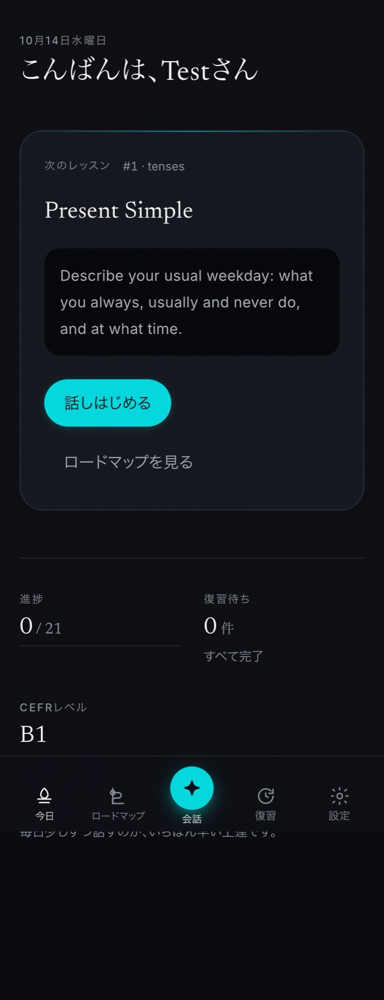
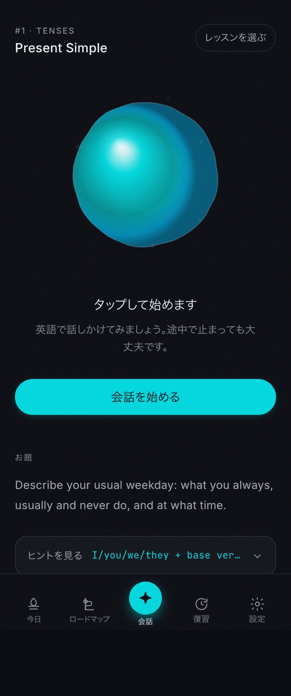
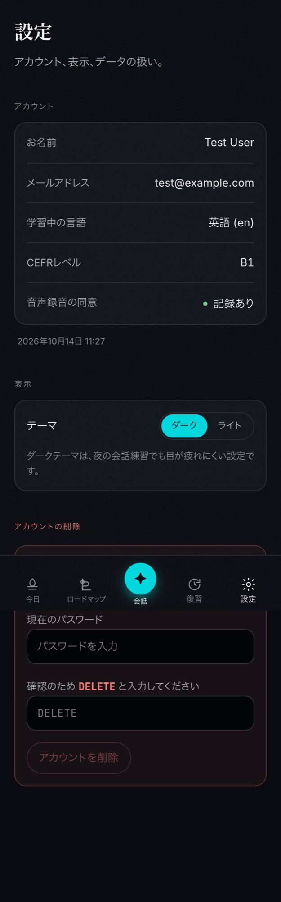
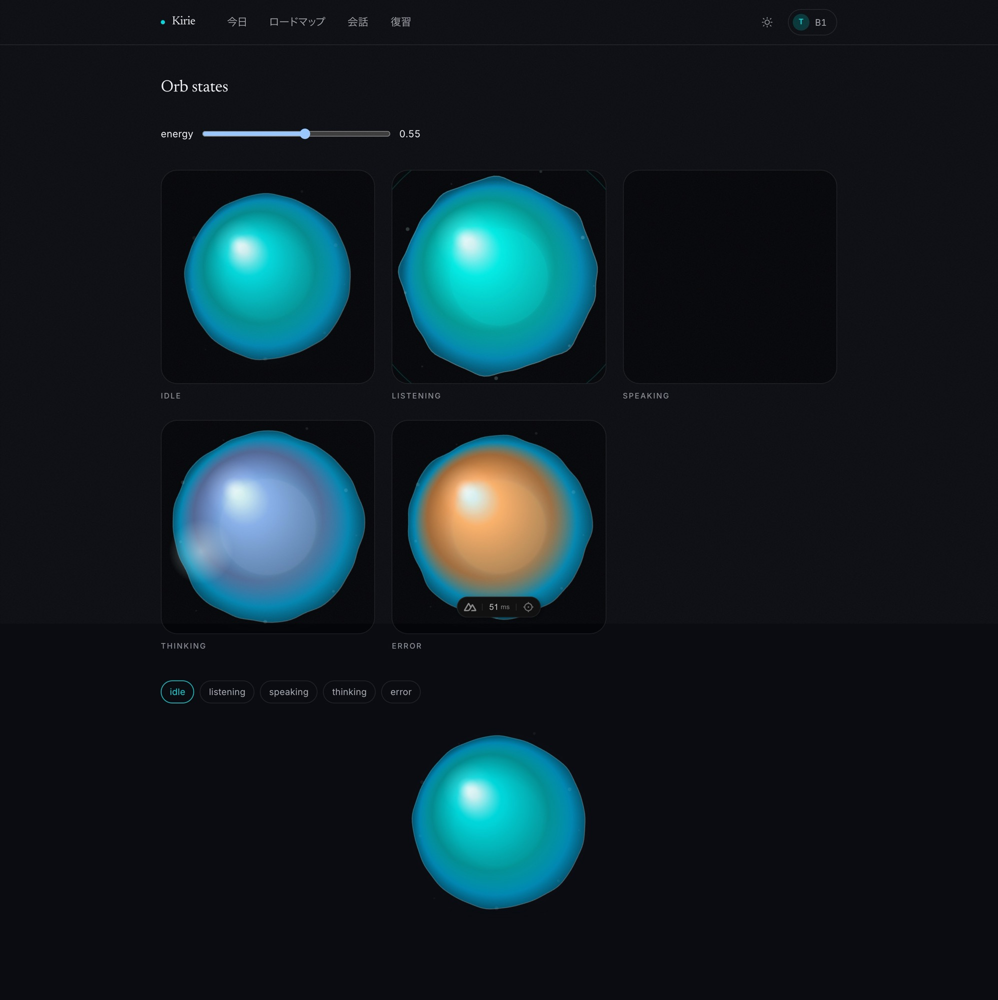
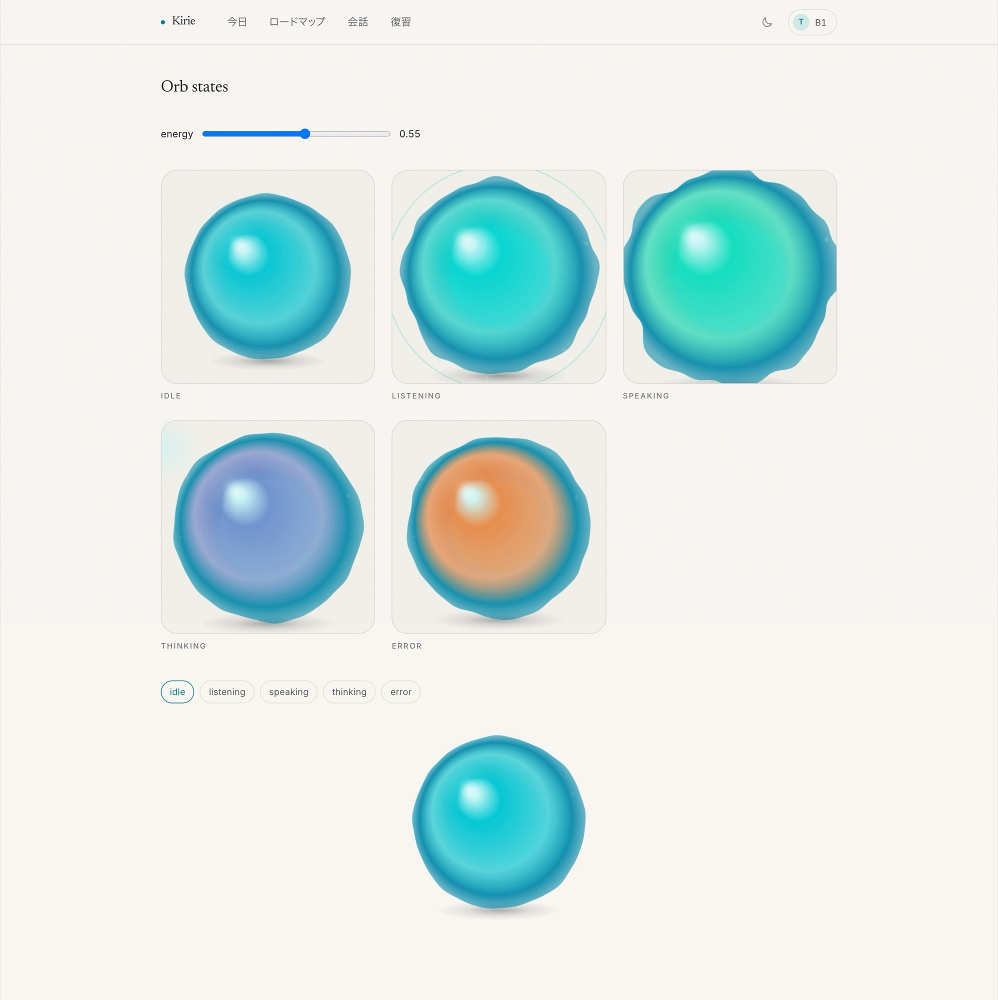
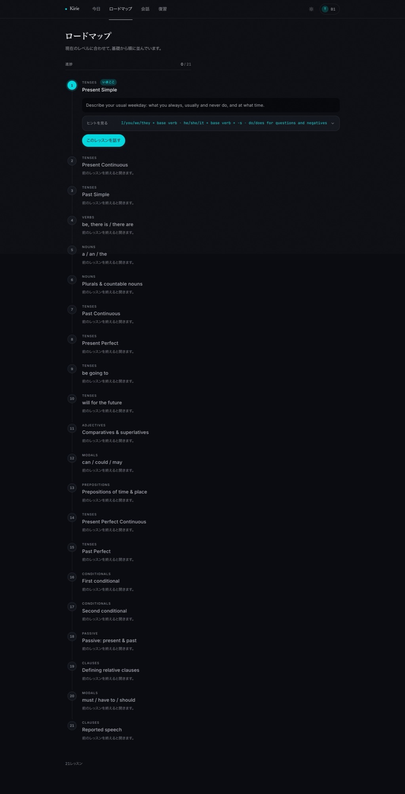

# AI Language Coach — “Kirie”

Voice AI coach for learning **English** (CEFR A1–C1) for Japanese-speaking learners: onboarding level assessment, a personalized grammar roadmap, two conversation modes with a real-time voice agent (a lesson focused on a grammar topic with in-line correction, and a role-play scenario with a post-conversation review), and spaced repetition (SM-2) based on mistakes.

- **Interface:** Japanese (`frontend/app/constants/strings.ts`); learning content — English (from the API).
- **Brand:** **Kirie** (`APP_NAME=Kirie` in the backend and `app.name` in the frontend).

## Interface Screenshots

| 今日 (Today) | 会話 (Voice Practice) | 設定 (Settings) |
|:---:|:---:|:---:|
|  |  |  |

| Voice orb states (Dark) | Voice orb states (Light) |
|:---:|:---:|
|  |  |

<details>
<summary><strong>ロードマップ (Grammar Roadmap — Desktop)</strong></summary>
<br />
<p align="center">
  
</p>
</details>

### Module Documentation

| Document | Contents |
|---|---|
| [`ai-language-coach-plan.md`](ai-language-coach-plan.md) | Architecture plan and milestones |
| [`frontend/README.md`](frontend/README.md) | Nuxt 4 SPA, routes, design system, and voice orb |
| [`docs/scenario-practice.md`](docs/scenario-practice.md) | Plan and implementation of scenario practice: the second conversation mode and goal-achievement review |
| [`docs/design/README.md`](docs/design/README.md) | Design system and reference screen renders |
| [`agent/README.md`](agent/README.md) | Python voice worker (`livekit-agents`) |
| [`e2e/README.md`](e2e/README.md) | Playwright E2E smoke tests |
| [`benchmarks/README.md`](benchmarks/README.md) | First-token latency benchmark for conversational LLMs |
| [`load/README.md`](load/README.md) | Voice pool load testing and SIGTERM drain verification |
| [`infra/README.md`](infra/README.md) | Terraform IaC (AWS ECS, RDS, ElastiCache, LiveKit EC2) |
| [`docs/deployment.md`](docs/deployment.md) | Single-host production deployment runbook (`docker-compose.prod.yml`) |
| [`PRIVACY.md`](PRIVACY.md) | Voice data consent, retention, and deletion policy |

---

## Stack

| Layer | Technologies |
|---|---|
| Frontend | Nuxt 4 (Vue 3, SPA `ssr: false`) + Tailwind CSS 4 + `@urql/vue` |
| Auth | Laravel Sanctum (SPA session cookie + CSRF) |
| API | Laravel 13 + Lighthouse GraphQL (`/graphql`) |
| Realtime | Laravel Reverb (Pusher protocol for GraphQL subscriptions through Laravel Echo) |
| Queues | Redis 7 + Laravel Horizon |
| DB | MySQL 8.4 |
| Media | LiveKit Server (WebRTC) |
| Voice Agent | Python 3.11 + `livekit-agents` |
| STT / TTS | Deepgram Nova-3 / Cartesia Sonic-3 |
| LLM (async) | DeepSeek-V3 through `laravel/ai` (mistake analysis, scenario goal review, and CEFR assessment) |
| LLM (dialogue) | Groq / Cerebras / OpenAI (`LLM_PROVIDER`; slow providers such as DeepSeek are blocked at startup) |
| Observability | Sentry (PII scrubber), CloudWatch Metrics (`TurnLatencyMs`, `VoiceSeconds`), Laravel Telescope (dev) |

### Main Dependencies

**Backend (`backend/composer.json`):**
- **Prod:** `laravel/framework` (^13.17), `nuwave/lighthouse` (^6.70), `laravel/sanctum` (^4.0), `laravel/reverb` (^1.11), `laravel/horizon` (^5.49), `laravel/ai` (^0.11.2), `dij-digital/deepgram-laravel` (^0.1.3), `aws/aws-sdk-php` (^3.395), `firebase/php-jwt` (^7.1), `sentry/sentry-laravel` (^4.27).
- **Dev:** `pestphp/pest` (^5.2), `phpunit/phpunit` (^13.3), `laravel/pint` (^1.27), `laravel/telescope` (^5.24), `rector/rector` (^2.6).

**Frontend (`frontend/package.json`):**
- **Prod:** `nuxt` (^4.5), `vue` (^3.5), `vue-router` (^5.3), `@urql/vue` (^2.1), `graphql` (^17.0), `laravel-echo` (^2.5), `pusher-js` (^8.6), `livekit-client` (^2.22), `tailwindcss` + `@tailwindcss/vite` (^4.3).
- **Dev:** `@graphql-codegen/cli` (^7.4), `@graphql-codegen/typescript` (^6.1), `typescript` (~5.9, pinned for compatibility with `vue-tsc`), `vue-tsc` (^3.3).

---

## Local Setup

### Option 1: Full Docker Launch

```bash
docker compose --profile full up -d
```

### Option 2: Hybrid Development Mode (Infrastructure in Docker, PHP/Nuxt on the Host)

**Requirements:** PHP 8.4+ (CI and images use `8.5.12`) with the `redis` extension (`pecl install redis`), Composer, Node 22+, Docker.

```bash
# 1. Infrastructure (MySQL 8.4, Redis 7, MinIO, LiveKit Server, Voice Agent)
cp .env.example .env
docker compose up -d
docker compose ps

# 2. Backend (http://localhost:8000)
cd backend
composer install
cp .env.example .env
php artisan key:generate
php artisan migrate
php artisan db:seed
php artisan serve             # also run in separate terminals: php artisan queue:work and php artisan reverb:start

# 3. Frontend (http://localhost:3000)
cd frontend
npm install
cp .env.example .env
npm run dev
```

> **LiveKit note:** The `coach_livekit` container is already started in step 1 (`ws://localhost:7880`). The alternative `./scripts/livekit-dev.sh` script is only needed to run a native `livekit-server` without Docker (do not run both at the same time — they use the same `7880` port).

### Test Database

Tests use a separate `language_coach_testing` database:

```bash
docker exec coach_mysql mysql -uroot -proot_password \
  -e "CREATE DATABASE IF NOT EXISTS language_coach_testing CHARACTER SET utf8mb4 COLLATE utf8mb4_unicode_ci; GRANT ALL PRIVILEGES ON language_coach_testing.* TO 'coach_user'@'%';"
cd backend && DB_DATABASE=language_coach_testing php artisan migrate
```

Demo account after `php artisan db:seed`: `test@example.com` / `password`.

---

## Containers and Production Images

| Component | Local address / mode |
|---|---|
| MySQL 8.4 (`coach_mysql`) | `127.0.0.1:3306` |
| Redis 7 (`coach_redis`) | `127.0.0.1:6379` |
| MinIO (`coach_minio`) | `127.0.0.1:9000` (API) / `127.0.0.1:9001` (Console) |
| LiveKit Server (`coach_livekit`) | `127.0.0.1:7880` |
| Voice Agent (`coach_voice_agent`) | Worker `ai-language-coach`, healthcheck `:8081` |
| Laravel API / Horizon / Reverb | On the host (`:8000` / `:8080`) or in Docker with `--profile full` |
| Nuxt Frontend | On the host (`:3000`) or in Docker with `--profile full` |

### Building Production Images

```bash
docker build -t ai-language-coach/api ./backend
docker build -t ai-language-coach/web ./frontend
docker build -t ai-language-coach/agent ./agent
```

The `ai-language-coach/api` image (nginx + php-fpm under supervisord on `:8080`) is used for all Laravel roles in ECS and `docker-compose.prod.yml`:
- `laravel-app`: default `CMD` (nginx + php-fpm on `:8080`)
- `horizon-worker`: `php artisan horizon`
- `reverb`: `php artisan reverb:start --host=0.0.0.0 --port=8081`
- `scheduler`: `php artisan schedule:work`
- `migrations`: `php artisan migrate --force`

Quick check for built images:
```bash
./scripts/verify-images.sh
```

---

## Architectural Invariants and Configuration

- **Production environment security (`ProductionSanityCheck`):** When `APP_ENV=production`, the application refuses to start if `APP_DEBUG=true`, `SESSION_SECURE_COOKIE!=true`, `CORS_ALLOWED_ORIGINS` or `REVERB_ALLOWED_ORIGINS` contains `*`, or if `APP_KEY`, `LIVEKIT_API_SECRET`, or `VOICE_INTERNAL_SECRET` matches the default dev values from `backend/config/dev-defaults.php`.
- **GraphQL and type generation:**
  - The schema is split between `backend/graphql/schema.graphql` and domain files in `backend/graphql/types/*.graphql`.
  - Native PHP enums are registered through `App\GraphQL\Types\NativeEnumType` and duplicated in `backend/graphql/codegen-enums.graphql` for the frontend type generator.
  - After changing `.graphql` files, run `php artisan lighthouse:clear-cache` and `npm --prefix frontend run codegen`.
  - Query depth and complexity limits are enabled (`LIGHTHOUSE_MAX_QUERY_DEPTH=10`, `LIGHTHOUSE_MAX_QUERY_COMPLEXITY=50`), along with AST caching in `LIGHTHOUSE_QUERY_CACHE_MODE=opcache` mode (compatible with `cache.serializable_classes => false` in Laravel 13).
- **GraphQL subscriptions through Reverb:**
  - Require `LIGHTHOUSE_BROADCASTER=reverb` and `LIGHTHOUSE_SUBSCRIPTION_STORAGE=redis`.
  - The client handshake is encapsulated in `frontend/app/composables/useLighthouseSubscription.ts` (private channel authorization at `/graphql/subscriptions/auth` and unpacking of the `{more, result}` envelope).
- **Voice sessions and telemetry:**
  - The `requestVoiceToken(lessonCardId | scenarioCode)` call accepts exactly one subject (lesson or scenario), checks the daily limit (`VOICE_DAILY_SESSION_LIMIT`, 10 sessions/day by default in UTC under `lockForUpdate()`), creates a LiveKit room, dispatches the agent, and waits for it to join until `VOICE_AGENT_JOIN_TIMEOUT`.
  - Session lifecycle is managed idempotently through `App\Voice\VoiceSessionLifecycle` (webhooks at `/api/webhooks/livekit` and internal agent endpoints `/api/internal/sessions/{id}/fail` and `/turns`, protected by `X-Internal-Secret`).
- **Privacy and data retention (`PRIVACY.md`):**
  - Consent is recorded server-side in `users.voice_consent_at` when a recording is first submitted or a call is started.
  - Account deletion (`deleteAccount` / `php artisan privacy:delete-user`) cascades across the database, active Redis subscriptions, and S3 objects.
  - Daily jobs `privacy:purge-transcripts` (90 days) and `privacy:purge-orphan-audio` (7 days) remove stale data.

---

## Testing and CI (`.github/workflows/ci.yml`)

| Check | Command |
|---|---|
| **Backend Tests (Pest/PHPUnit)** | `cd backend && php artisan test --compact` |
| **Backend Code Style (Pint)** | `cd backend && ./vendor/bin/pint --test` |
| **Frontend GraphQL Codegen & Typecheck** | `cd frontend && npm run codegen && npm run typecheck && npm run build` |
| **Voice Agent Tests (Python)** | `cd agent && python3 -m unittest discover -s . -p "test_*.py"` |
| **E2E Smoke Suite (Playwright)** | `npx playwright test` |
| **Container Smoke Verification** | `./scripts/verify-images.sh` |
